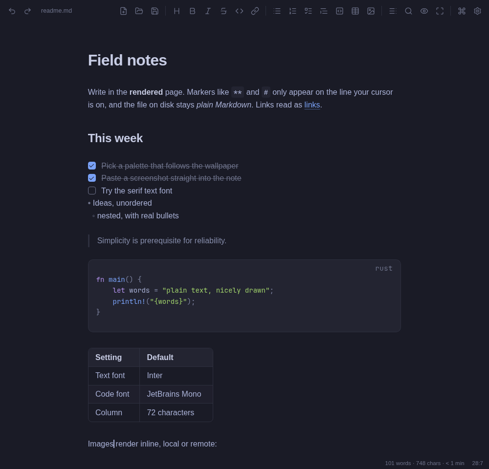
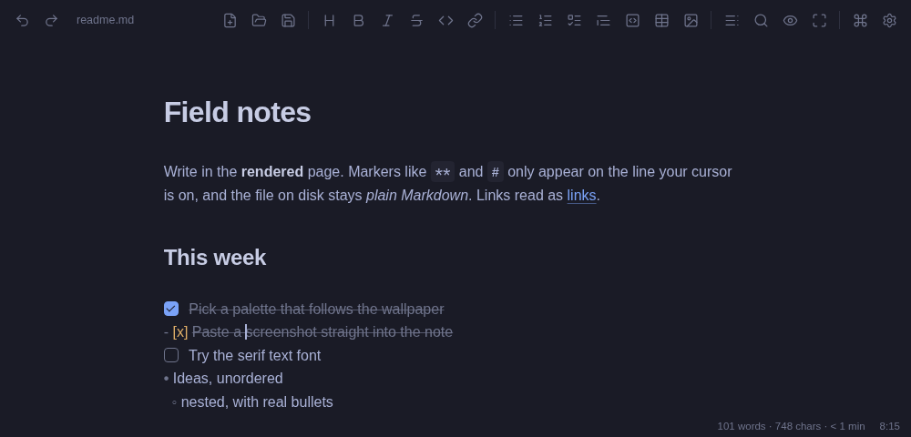
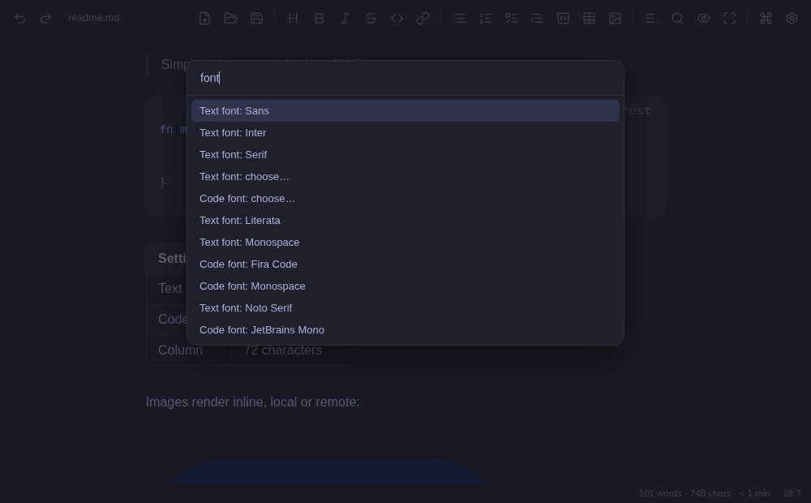
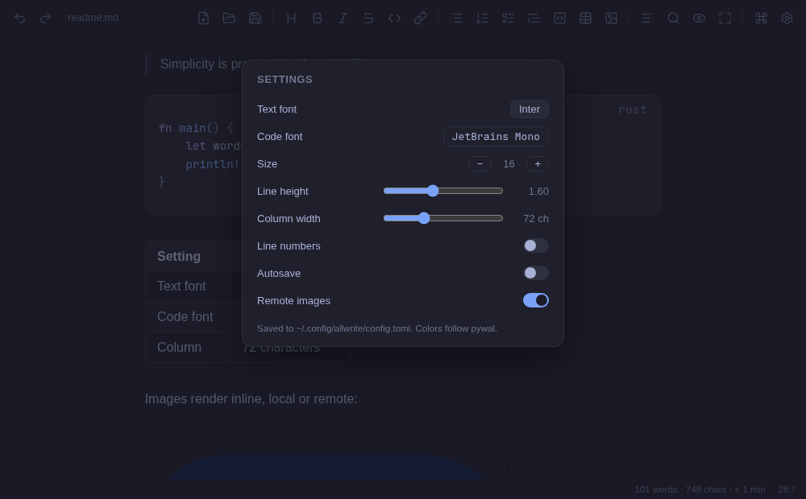
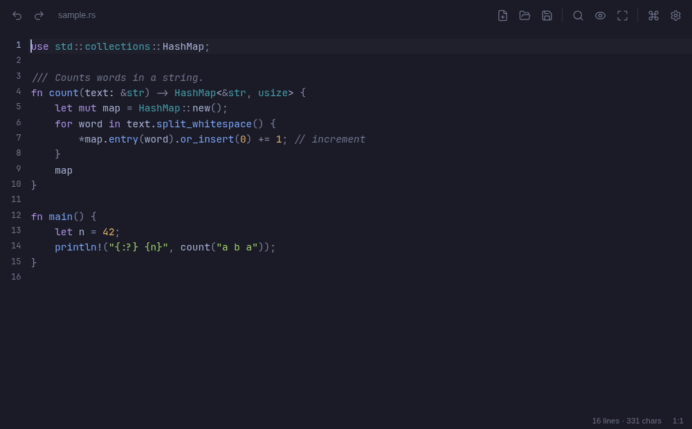
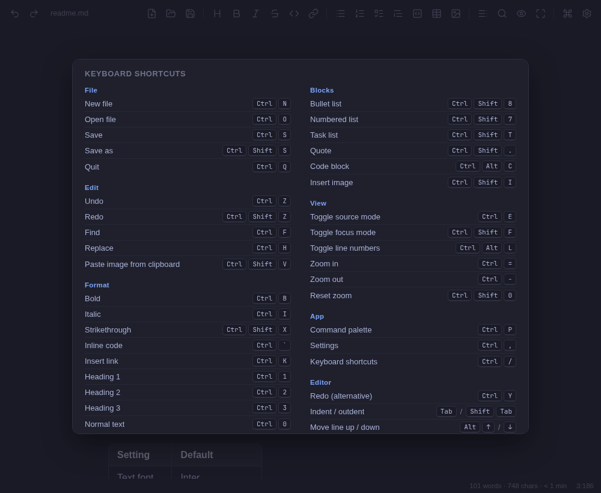

<div align="center">


# allwrite

**A small, fast Markdown editor for Linux that you write in rendered.**

There's no separate preview pane. Headings, lists, tables, code and images are
drawn as you type, the raw Markdown shows only on the line your cursor is on,
and the file on disk stays exactly the plain text you wrote.

[Install](#install) · [Features](#features) · [Keyboard](#keyboard) · [Settings](#settings) · [Your data](#your-data) · [Building](#building-from-source)



</div>

allwrite is built with Rust, [Tauri 2](https://tauri.app) and
[CodeMirror 6](https://codemirror.net). It uses your system's WebKitGTK, so
there's no bundled browser, and it follows your [pywal](https://github.com/dylanaraps/pywal)
colours live. It was made for Hyprland, and runs on any Linux desktop.

## Features

**Write in the rendered page.**
- `# Headings`, **bold**, *italic*, ~~strikethrough~~, `inline code` and links are styled in place, and their markers disappear.
- Step onto a line and its Markdown comes back, dimmed, so you can edit it. Step off and it's drawn again.
- Bullets, numbered lists, clickable task checkboxes, quotes, horizontal rules, fenced code blocks with syntax highlighting, and GFM tables.
- `Ctrl E` switches to source mode and shows the raw text of the whole file.
- allwrite never reformats your document. It only changes how the text is drawn, and what's saved is exactly what you typed.



**Images inline.**
- Local images (relative or absolute paths) and remote ones are shown right in the note.
- Paste a screenshot or drag in a file and it's saved next to your note, in `assets/`, with the link written for you. `Ctrl Shift V` reads the system clipboard directly (`wl-paste` on Wayland, `xclip` on X11).
- A broken path shows a small "image not found" placeholder instead of breaking the page.

**Your colours, live.** allwrite reads pywal's `colors.json` and recolours the
moment your wallpaper changes, with no restart. Without pywal it follows your
desktop's light or dark preference and accent colour through the XDG portal.
A contrast check keeps text readable on any palette.

**Every action in one place.** All actions live in a single command
registry, so the top bar buttons, keyboard shortcuts and the command palette
(`Ctrl P`) can never drift apart. The palette also switches fonts and opens
recent files.

<table>
<tr>
<td></td>
<td></td>
</tr>
<tr>
<td></td>
<td></td>
</tr>
</table>

**Markdown, plain text and code.**
- `.md` files get live preview; `.txt` and unknown files get a clean prose view.
- Code files get syntax highlighting, a code font and line numbers. Each language loads only when a file needs it.
- Files that aren't valid UTF-8 open read-only, with a notice.

**Fonts.** You pick a text font and a code font from every font installed on
your system, plus size, line height and column width. Inter and JetBrains
Mono are the defaults.

**Light on your computer.**
- It opens in about a third of a second.
- It uses no CPU while idle: file and palette changes come from inotify and D-Bus signals, never polling.
- Software rendering with the JIT off, so it never wakes a sleeping discrete GPU on hybrid laptops.

**Safe with your files.**
- Saves are atomic: allwrite writes a temporary file, then renames it over the original.
- If another program changes the file, allwrite reloads it quietly when you have no unsaved edits, and otherwise asks whether to reload or keep yours.
- It asks before closing with unsaved changes. Autosave is optional and off by default.

**Everything else.** Find and replace, go to heading (`Ctrl Shift O`), go to
line, focus mode that hides the bars, zoom, optional line numbers for prose,
a word / character / reading-time count, and a keyboard shortcut sheet
(`Ctrl /`).

## Install

### One line (any Linux distribution)

```bash
curl -fsSL https://raw.githubusercontent.com/ahaan-shah/allwrite/main/install.sh | sh
```

The script installs `allwrite` into `~/.local/bin` and adds a menu entry and
icon, just for you (no root). It works on x86-64 and ARM64 and checks the
download against the release's `checksums.txt`.
- To also make allwrite your default app for Markdown files, use `sh -s -- --default` in place of `sh`.
- To install a specific version, set `ALLWRITE_VERSION=0.1.0` first.
- To uninstall, use `sh -s -- --uninstall` in place of `sh`. Your settings are kept.

allwrite needs **WebKitGTK 4.1**, which most desktops already have:

| Distribution | Package |
|---|---|
| Arch | `webkit2gtk-4.1` |
| Debian / Ubuntu | `libwebkit2gtk-4.1-0` |
| Fedora | `webkit2gtk4.1` |

Optional extras: `python-pywal` (or `pywal16`) for live colours, `wl-clipboard`
or `xclip` for pasting images, and the Inter and JetBrains Mono fonts.

### Debian, Ubuntu and Fedora packages

The [latest release](https://github.com/ahaan-shah/allwrite/releases/latest)
has `.deb` and `.rpm` packages for x86-64 and ARM64, which pull in their
dependencies:

```bash
sudo apt install ./allwrite_*_amd64.deb        # Debian / Ubuntu
sudo dnf install ./allwrite-*.x86_64.rpm       # Fedora
```

It also has portable `.tar.gz` archives with the binary, icon and `.desktop`
file.

### Arch Linux

Build a package from a checkout with the included PKGBUILD:

```bash
git clone https://github.com/ahaan-shah/allwrite.git
cd allwrite/packaging && makepkg -si
```

## Keyboard

| Keys | Does |
|---|---|
| `Ctrl N` · `Ctrl O` · `Ctrl S` · `Ctrl Shift S` | New · open · save · save as |
| `Ctrl P` | Command palette |
| `Ctrl ,` | Settings |
| `Ctrl /` | All shortcuts |
| `Ctrl F` · `Ctrl H` | Find · replace |
| `Ctrl B` · `Ctrl I` · `Ctrl Shift X` · ``Ctrl ` `` | Bold · italic · strikethrough · inline code |
| `Ctrl 1` – `Ctrl 3` · `Ctrl 0` | Heading 1–3 · normal text |
| `Ctrl K` · `Ctrl Shift I` | Insert link · insert image |
| `Ctrl Shift 8` · `Ctrl Shift 7` · `Ctrl Shift T` · `Ctrl Shift .` | Bullet list · numbered list · task list · quote |
| `Ctrl Alt C` | Code block |
| `Ctrl Shift V` | Paste image from the system clipboard |
| `Ctrl Shift O` · `Ctrl Alt G` | Go to heading · go to line |
| `Ctrl E` | Source mode |
| `Ctrl Shift F` | Focus mode |
| `Ctrl Alt L` | Line numbers |
| `Ctrl =` · `Ctrl -` · `Ctrl Shift 0` | Zoom in · out · reset |
| `Ctrl Z` · `Ctrl Shift Z` | Undo · redo |
| `Ctrl Q` | Quit (asks if unsaved) |

`Ctrl`-click opens a link. Any shortcut can be changed in the config file
(see below).

### From the command line

```bash
allwrite                 # a new, untitled note
allwrite notes/today.md  # open (or create) a file
```

## Settings

Most settings are in the settings panel (`Ctrl ,`) and apply immediately.
They're saved to `~/.config/allwrite/config.toml`, which you can also edit
by hand:

```toml
[font]
text = "Inter"
code = "JetBrains Mono"
size = 16
line_height = 1.6
column_width = 72        # characters

[app]
autosave = false
remote_images = true     # false: never fetch images from the web
line_numbers = false     # for Markdown and text; code files always have them

[keys]                   # command id = key combo
bold = "Ctrl+B"
focus = "Ctrl+Shift+F"

[theme]                  # palette slot = pywal key or hex colour
accent = "color4"
heading = "foreground"   # e.g. "color6" for coloured headings
```

## Your data

There's no account, no telemetry and no update check. allwrite only touches
the network to load remote images in a note you open, and you can turn that
off with `remote_images = false`.

| | Where |
|---|---|
| Settings | `~/.config/allwrite/config.toml` |
| Recent files | `~/.local/state/allwrite/recent.json` |
| Pasted images | an `assets/` folder next to the note |

## Building from source

```bash
git clone https://github.com/ahaan-shah/allwrite.git
cd allwrite
npm ci
npx tauri build --no-bundle       # binary: src-tauri/target/release/allwrite
scripts/install.sh                # install it for your user (add --default for .md files)
```

You need Rust (stable), Node.js 22+, and the WebKitGTK 4.1 and GTK 3
development files. On Arch:
`sudo pacman -S --needed base-devel rust nodejs npm webkit2gtk-4.1 gtk3`;
on Debian / Ubuntu: `sudo apt install build-essential libwebkit2gtk-4.1-dev libgtk-3-dev librsvg2-dev`.

```bash
npm test                              # frontend tests (vitest)
(cd src-tauri && cargo test --release) # backend tests
npx tauri dev                         # run with hot reload
```

[PLAN.md](PLAN.md) is the design spec, and [CLAUDE.md](CLAUDE.md) has notes
on the code's layout and its traps.

## Credits

allwrite stands on [Tauri](https://tauri.app), [CodeMirror](https://codemirror.net)
and [Lezer](https://lezer.codemirror.net), [Lucide](https://lucide.dev) icons
(ISC), and [pywal](https://github.com/dylanaraps/pywal) for the colours.

## License

[MIT](LICENSE).
